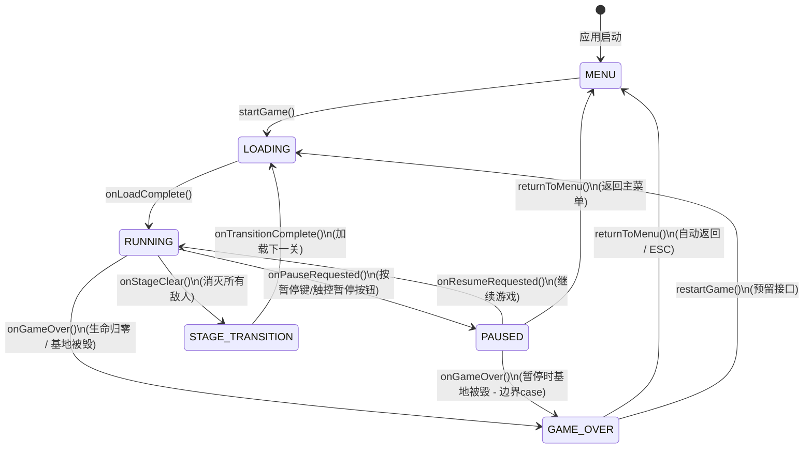

# UI Interaction Flow — Battle City 1985

## 1. 应用状态流转图

```
                    ┌──────────────────────────────────────────────────────────┐
                    │                    Battle City 1985                      │
                    │                      状态流转总图                         │
                    └──────────────────────────────────────────────────────────┘

                                    ┌─────────────┐
                                    │   应用启动    │
                                    └──────┬──────┘
                                           │
                                           ▼
                               ┌───────────────────────┐
                               │      MainPage          │
                               │    (主菜单页面)         │
                               │                       │
                               │  ┌─────────────────┐  │
                               │  │  开始游戏        │──┼──────────────────────┐
                               │  ├─────────────────┤  │                      │
                               │  │  关卡选择        │──┼──────────┐           │
                               │  ├─────────────────┤  │          │           │
                               │  │  设置            │──┼──┐       │           │
                               │  └─────────────────┘  │  │       │           │
                               └───────────────────────┘  │       │           │
                                           │              │       │           │
                                           ▼              │       ▼           ▼
                               ┌───────────────────────┐  │  ┌────────────────────┐
                               │    SettingPage         │  │  │  LevelSelectPage   │
                               │    (设置页面)          │  │  │  (关卡选择页面)     │
                               │                       │  │  │                    │
                               │  · BGM 音量调节       │  │  │  STAGE 01 ~ STAGE  │
                               │  · SFX 音效调节       │  │  │  10 关卡卡片       │
                               │  · 游戏规则说明       │  │  │                    │
                               │  · 操作说明          │  │  │  点击关卡 →        │
                               │  · 道具说明          │  │  │  setPendingStage()  │
                               │                       │  │  │  router.pushUrl    │
                               │  ← BΛCK 返回主菜单    │  │  │  → GamePage        │
                               └───────────────────────┘  │  └─────────┬──────────┘
                                           │              │            │
                                           │              │            │
                              router.back()│              │            │
                                           │              │            │
                                           ▼              │            ▼
                               ┌───────────────────────┐  │  ┌────────────────────┐
                               │      MainPage          │◄─┘  │     GamePage       │
                               └───────────────────────┘     │   (游戏主页面)      │
                                                             │                    │
                                                             │  ┌──────────────┐  │
                                                             │  │ 游戏内状态机  │  │
                                                             │  │              │  │
                                                             │  │ MENU         │  │
                                                             │  │   ↓          │  │
                                                             │  │ LOADING      │  │
                                                             │  │   ↓          │  │
                                                             │  │ RUNNING ◄───►│  │
                                                             │  │   ↓    PAUSED │  │
                                                             │  │ STAGE_       │  │
                                                             │  │ TRANSITION   │  │
                                                             │  │   ↓          │  │
                                                             │  │ GAME_OVER    │  │
                                                             │  └──────────────┘  │
                                                             └────────────────────┘
```

## 2. 游戏内状态机详细流转

### 2.1 状态定义（GameState 枚举）

| 状态 | 枚举值 | 说明 | 前置状态 | 后置状态 |
|------|--------|------|---------|---------|
| **MENU** | `0` | 菜单状态，未进入游戏 | 初始 / GAME_OVER | LOADING |
| **LOADING** | `1` | 加载关卡资源中 | MENU / STAGE_TRANSITION | RUNNING |
| **RUNNING** | `2` | 游戏正常运行中 | LOADING / PAUSED(恢复) | PAUSED / STAGE_TRANSITION / GAME_OVER |
| **PAUSED** | `3` | 游戏暂停中 | RUNNING | RUNNING(恢复) / MENU(返回) |
| **STAGE_TRANSITION** | `4` | 关卡通关过渡动画 | RUNNING(通关) | LOADING(下一关) |
| **GAME_OVER** | `5` | 游戏结束 | RUNNING / PAUSED(基地被毁/生命归零) | MENU(返回) / LOADING(重新开始) |

### 2.2 状态流转图（Mermaid）



### 2.3 开场动画序列（Intro Phase）

```
IntroPhase 0-240 帧（约 4 秒，60FPS）

  Phase   0~30  : 黑色遮罩渐隐 (alpha: 1 → 0)
  Phase  30~100 : 关卡标题显示 + 缩放动画
                  "◈  STΛGE  XX  ◈"  (绿色 #00FF41)
                  "PREPARE FOR BATTLE" (金色 #FFD740)
  Phase 100~160 : "READY?" 闪烁效果 (青色 #00E5FF)
                  底部装饰线闪烁 (品红 #FF00FF)
  Phase 160~220 : "GO!" 放大 + 粒子爆发
                  50 个彩色粒子散开
  Phase 220~240 : 清屏，开始游戏
```

## 3. 页面导航路径

### 3.1 路由表（main_pages.json）

| 路由路径 | 页面组件 | 说明 |
|---------|---------|------|
| `pages/Index` | Index | 占位索引页（Hello World） |
| `pages/MainPage` | MainPage | 主菜单（应用默认入口） |
| `pages/GamePage` | GamePage | 游戏主页面 |
| `pages/LevelSelectPage` | LevelSelectPage | 关卡选择页 |
| `pages/SettingPage` | SettingPage | 设置页 |

### 3.2 导航交互路径

```
MainPage ──→ 开始游戏 (router.pushUrl) ──→ GamePage
           ├─→ 关卡选择 (router.pushUrl) ──→ LevelSelectPage
           │                                   └→ 点击关卡 → setPendingStage() → GamePage
           └─→ 设置 (router.pushUrl) ──→ SettingPage

GamePage ──→ 暂停面板 → 返回主菜单 (router.back) ──→ MainPage
         ├─→ GAME OVER 结束 (router.back) ──→ MainPage
         └─→ 通关全部10关 → 循环回第1关

LevelSelectPage ──→ ← BΛCK (router.back) ──→ MainPage
SettingPage ──→ ← BΛCK (router.back) ──→ MainPage
```

## 4. 交互路径与手势说明

### 4.1 主菜单 (MainPage) 交互

| 交互目标 | 触发方式 | 反馈效果 | 导航目标 |
|---------|---------|---------|---------|
| 开始游戏 (START GAME) | 点击按钮区域 | 无动画直接跳转 | GamePage |
| 关卡选择 (SELECT STAGE) | 点击按钮区域 | 无动画直接跳转 | LevelSelectPage |
| 设置 (SETTINGS) | 点击按钮区域 | 无动画直接跳转 | SettingPage |

**入场动画序列**（自动播放，不可交互打断）：
- 300ms: 顶部 "TΛNK WΛRFΛRE" 标题 + 分隔线出现
- 600ms: "BΛTTLE" 从左滑入
- 750ms: "CITY" 从右滑入
- 1400ms: 副标题 "TΛNK · 1985" 淡入
- 1800ms-2400ms: 三个按钮依次从右侧滑入 (间隔 300ms)
- 2800ms: 底部版本号淡入

### 4.2 关卡选择 (LevelSelectPage) 交互

| 交互目标 | 触发方式 | 反馈效果 | 导航目标 |
|---------|---------|---------|---------|
| 返回主菜单 | 点击 "← BΛCK" | router.back() | MainPage |
| 选择关卡 | 点击关卡卡片 | setPendingStage(stage-1) → router.pushUrl | GamePage |
| 滚动浏览 | 触摸滑动手势 | Scroll 组件自动处理 | 无导航 |

**入场动画**：
- 200ms: Header 出现
- 350ms + i×60ms: 10 个关卡卡片依次从右侧滑入（间隔 60ms）

**关卡颜色映射**（10 关独立强调色）：
```
STAGE 01: #00FF41 (亮绿)    STAGE 06: #69F0AE (柔绿)
STAGE 02: #00E5FF (青色)    STAGE 07: #40C4FF (亮蓝)
STAGE 03: #FF00FF (品红)    STAGE 08: #FF5252 (红)
STAGE 04: #FF5722 (深橙)    STAGE 09: #00BFA5 (青绿)
STAGE 05: #FFD740 (金色)    STAGE 10: #FF9100 (橙色)
```

### 4.3 设置页面 (SettingPage) 交互

| 交互目标 | 触发方式 | 反馈效果 |
|---------|---------|---------|
| BGM 音量 | 拖动 Slider (0-100) | 实时更新 `AudioManager.setBgmVolume()` |
| SFX 音量 | 拖动 Slider (0-100) | 实时更新 `AudioManager.setSfxVolume()` |
| 返回 | 点击 "← BΛCK" | router.back() |
| 滚动 | 触摸滑动手势 | Scroll 组件 |

**入场动画**：
- 200ms: 返回按钮 + 标题出现
- 500ms: 音量卡片淡入（上移）
- 900ms: RULES 章节淡入
- 1200ms: CONTROLS 章节淡入
- 1500ms: POWER-UPS 章节淡入

### 4.4 游戏页面 (GamePage) 触摸交互

#### 4.4.1 布局分区

```
┌──────────────────────────────────────────────────────────────┐
│                         横屏布局                              │
│                                                              │
│  ┌──────────┐ ┌─────────────────────────┐ ┌──────┐ ┌──────┐ │
│  │          │ │                         │ │      │ │      │ │
│  │  D-Pad   │ │    游戏 Canvas 画布      │ │ FIRE │ │ HUD  │ │
│  │  虚拟    │ │                         │ │ 按钮 │ │ 信息 │ │
│  │  方向键  │ │  tileSize = H/16        │ │      │ │ 栏   │ │
│  │          │ │  gameCanvasSize = H     │ │      │ │      │ │
│  │          │ │  (正方形 16×16 瓦片)     │ │ 暂停 │ │      │ │
│  │          │ │                         │ │ 按钮 │ │      │ │
│  └──────────┘ └─────────────────────────┘ └──────┘ └──────┘ │
│                                                              │
│  ← w*18% → ←─────── 自适应 ───────→ ← w*12% → ← w*15% →   │
└──────────────────────────────────────────────────────────────┘
```

#### 4.4.2 触摸操作详解

| 区域 | 手势 | 触发条件 | 功能 |
|------|------|---------|------|
| 左侧 D-Pad (上) | Touch Down/Move | `tx 在 DPadCX ± half` 且 `ty 在 上方按钮区域` | 设置 dy = -1 (向上) |
| 左侧 D-Pad (下) | Touch Down/Move | `tx 在 DPadCX ± half` 且 `ty 在 下方按钮区域` | 设置 dy = +1 (向下) |
| 左侧 D-Pad (左) | Touch Down/Move | `tx 在 左侧按钮区域` 且 `ty 在 DPadCY ± half` | 设置 dx = -1 (向左) |
| 左侧 D-Pad (右) | Touch Down/Move | `tx 在 右侧按钮区域` 且 `ty 在 DPadCY ± half` | 设置 dx = +1 (向右) |
| 左侧 D-Pad (全部) | Touch Up | 松开任意方向键 | 设置 dx=0, dy=0 |
| 右侧 FIRE 按钮 | Touch Down | `(tx - fireCX)² + (ty - fireCY)² < fireR²` | 触发开火 (firePressed = true) |
| 右侧 暂停按钮 | Touch Down | `(tx - pauseX)² + (ty - pauseY)² < pauseR²` | gamePaused = true |
| 暂停面板 - 继续 | Touch Down | 点击「继续游戏」按钮区域 | gamePaused = false |
| 暂停面板 - 返回 | Touch Down | 点击「返回主菜单」按钮区域 | router.back() |

#### 4.4.3 键盘操作映射

| 按键 | KeyCode | 数值 | 功能 |
|------|---------|------|------|
| **W** | KEYCODE_W | 2039 | 向上移动 |
| **A** | KEYCODE_A | 2017 | 向左移动 |
| **S** | KEYCODE_S | 2035 | 向下移动 |
| **D** | KEYCODE_D | 2020 | 向右移动 |
| **Space** | KEYCODE_SPACE | 2050 | 发射子弹 |
| **J** | KEYCODE_J | 2070 | 暂停/继续 |
| **ESC** | — | — | 暂停/继续 / GAME OVER后返回 |

#### 4.4.4 键盘输入处理流程

```
onKeyEvent(type, keyCode)
    │
    ├─ type === 0 (KeyDown)
    │   ├─ keyCode === 2070 (J) → 切换 gamePaused
    │   ├─ keyCode === 2050 (Space) → requestFire()
    │   └─ W/A/S/D → heldKeys[keyCode] = 1 → setInputDirection(kdx, kdy)
    │
    └─ type === 1 (KeyUp)
        └─ pendingUps[keyCode] = frameCounter
              └─ 4 帧后 → heldKeys[keyCode] = 0
```

### 4.5 游戏内 Canvas 区域交互（GAME OVER / 通关 / 暂停）

| 状态 | Canvas 覆盖层 | 交互方式 |
|------|-------------|---------|
| 暂停 (PAUSED) | 88% 黑色半透明遮罩 + 青色虚线框 + "◈ PΛUSED ◈" | 点击「继续游戏」恢复 / 点击「返回主菜单」返回 |
| 关卡通关 (STAGE_TRANSITION) | 88% 黑色半透明遮罩 + 金色虚线框 + "VICTORY" + "◈ STΛGE CLEΛR ◈" | 自动 180 帧后进入下一关 |
| 游戏结束 (GAME_OVER) | 82% 黑色半透明遮罩 + "GΛME OVER" + "[ PRESS ESC TO CONTINUE ]" | 按 ESC / 180 帧后自动返回 |

## 5. 主题切换

| 主题模式 | GamePage 背景 | Canvas 间隙填充色 | 触发方式 |
|---------|-------------|-----------------|---------|
| 暗色模式 (Dark) | `#0D0D1A` | `#0A0A14` | 系统默认 / `currentColorMode === DARK` |
| 浅色模式 (Light) | `#D6EAF8` | `#C5DCE8` | 系统设置切换 |

> **注**：MainPage、LevelSelectPage、SettingPage 固定使用暗色主题背景（`#060B14` / `#050B14`），不随系统主题切换。

## 6. 道具系统交互流程

```
道具坦克出现 (红色闪烁)
    │
    ├─ 第 4/11/18 个敌人 ← 红色闪烁道具坦克
    │
    └─ 击毁道具坦克 → 掉落随机道具
                       │
                       ▼
                  场上无道具 且 autoDropRespawnTimer === 0
                       │
                       ▼
                  随机地图空地生成道具
                       │
        ┌──────────────┼──────────────┬──────────────┬──────────────┐
        ▼              ▼              ▼              ▼              ▼
      手雷 💣        头盔 🛡        时钟 ⏱        铲子 🚧        坦克 ❤️
    (全灭敌人)    (10秒护盾)    (冻结敌人8秒)  (基地加固15秒)  (额外生命+1)
        │              │              │              │              │
        └──────────────┴──────────────┴──────────────┴──────────────┘
                                   │
                          autoDropRespawnTimer = 60
                          autoDropTypeIndex = nextType (循环 1→2→3→4→5→1)
```
